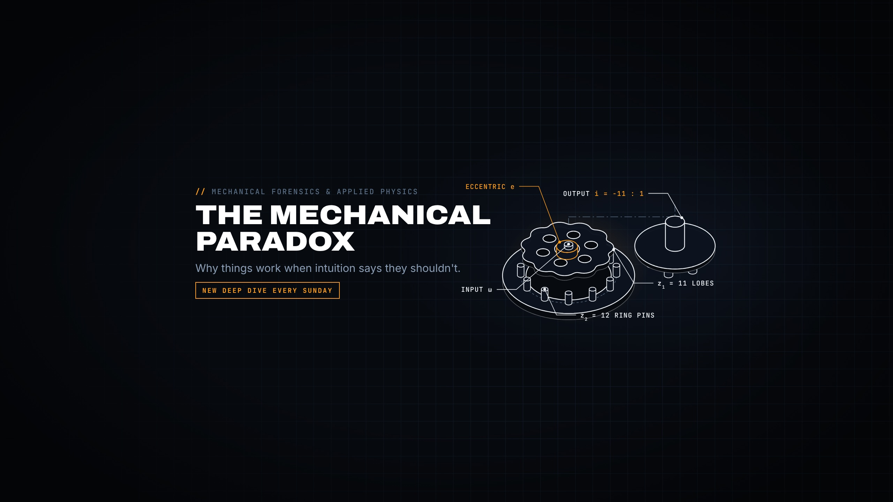

# The Mechanical Paradox

*The engineering that shouldn't work. The invisible physics that makes it.*



Code-rendered engineering documentaries for YouTube (`@themechanicalparadox`). Every frame is built in
[Remotion](https://www.remotion.dev/) from real geometry: the logo's three cycloidal gears really mesh (and really
can't turn), the banner's cycloidal drive really closes on all twelve pins.

- Rules for every session: [`CLAUDE.md`](CLAUDE.md)
- Everything else, including the owner's blueprint: [`docs/PLAYBOOK.md`](docs/PLAYBOOK.md)

```bash
npm ci                                                           # Remotion 4.0.534, React 19
npx tsc --noEmit                                                 # typecheck
npx remotion still src/index.ts ChannelSting out.jpg --frame=300 # a still
node scripts/render_shards.mjs . ChannelSting out --scale 2/3    # a short 720p test render
python3 brand/build_logo.py && python3 brand/build_banner.py     # rebuild the brand art
```
